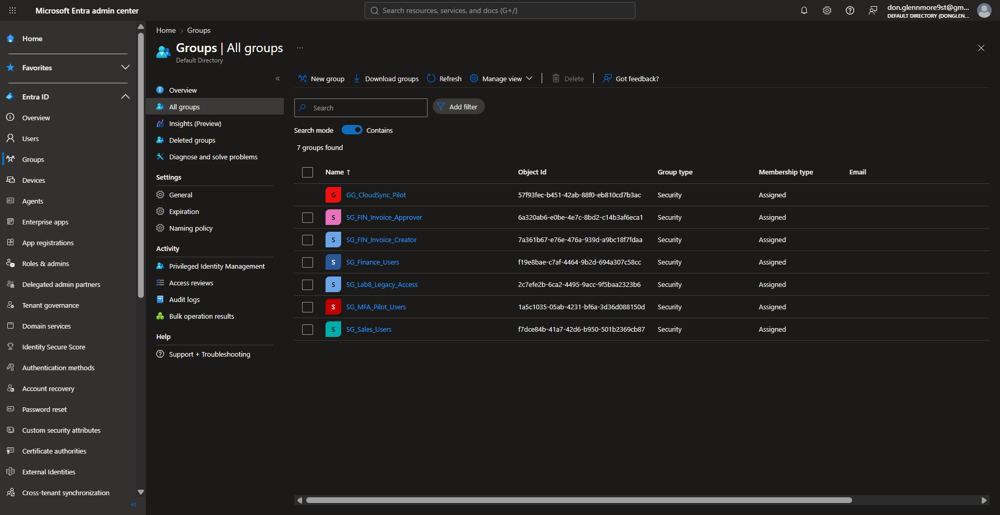
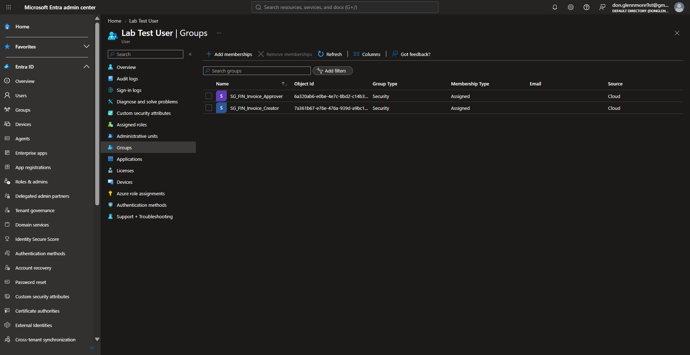
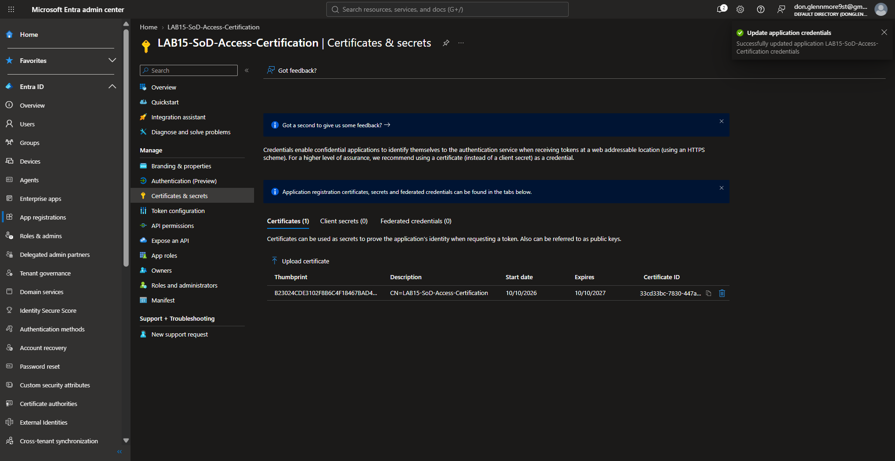
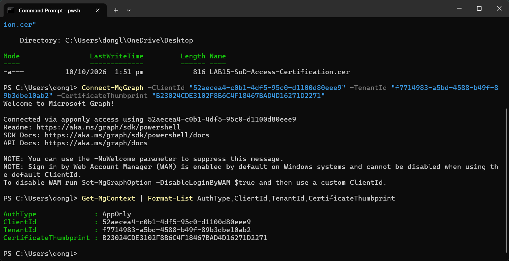
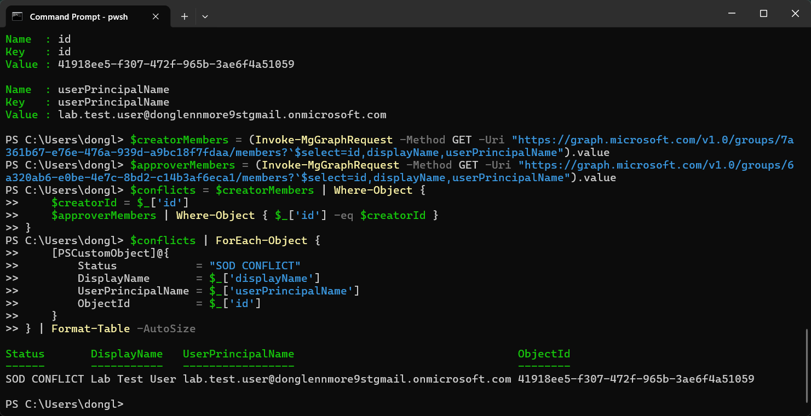
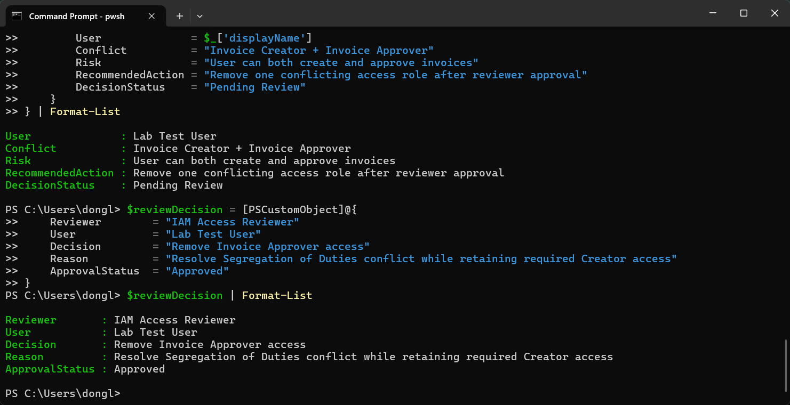
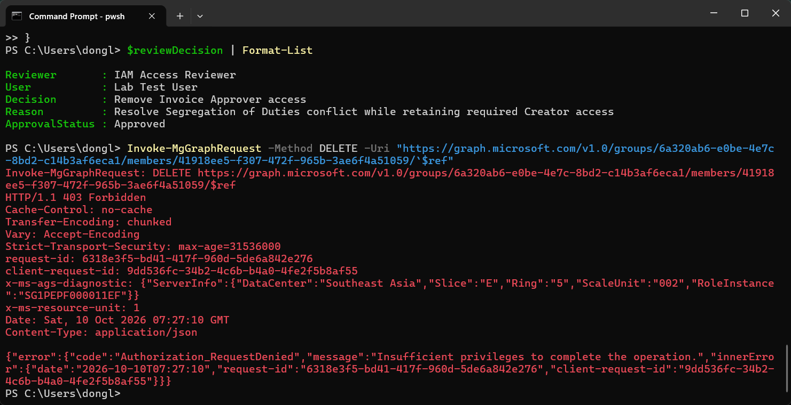
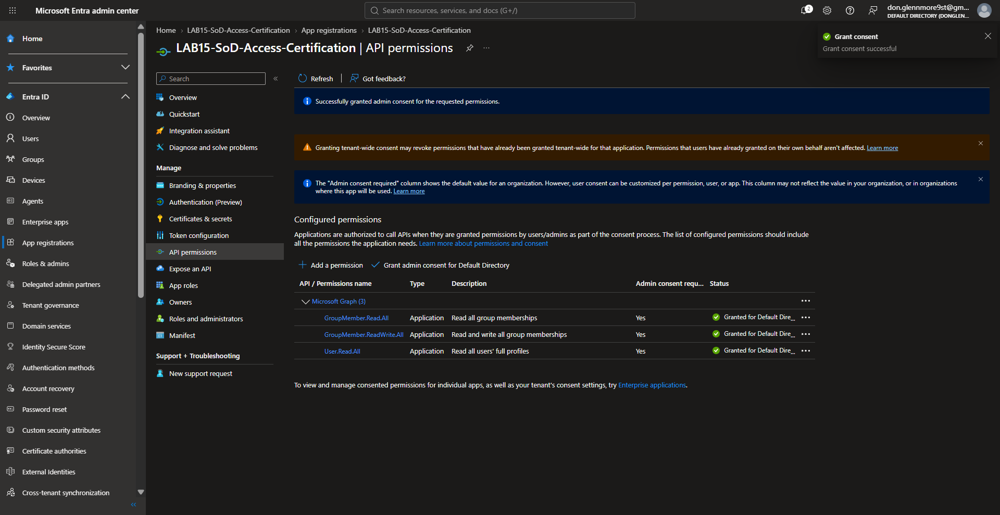
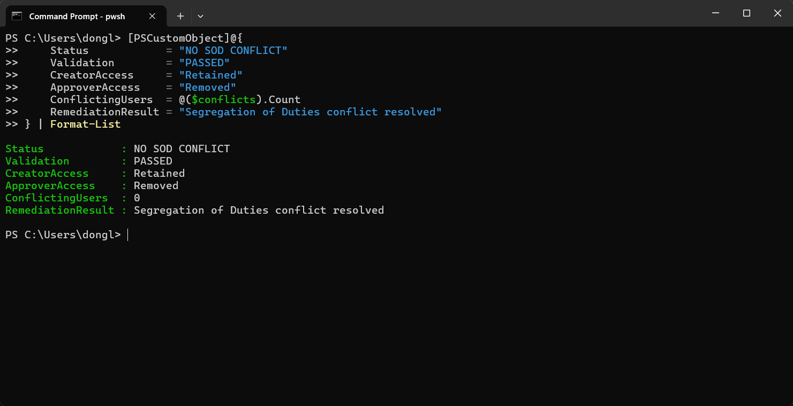

## Evidence Gallery & Validation

The screenshots below document the complete Lab 15 workflow from access-model setup and SoD conflict detection through reviewer approval, permission troubleshooting, remediation, and final validation.

### 1. SoD Access Model Groups

Created the two finance security groups representing conflicting business functions:

- `SG_FIN_Invoice_Creator`
- `SG_FIN_Invoice_Approver`

---

### 2. Initial SoD Conflict Present

The test identity was intentionally assigned to both incompatible finance groups to create a controlled Segregation of Duties conflict.

---

### 3. Microsoft Graph Application Permissions and Admin Consent

Configured Microsoft Graph Application permissions for the Lab 15 workload identity and granted tenant-wide admin consent.

.png)

---

### 4. X.509 Certificate Registered in Microsoft Entra

Registered the public X.509 certificate with the Lab 15 App Registration for certificate-based workload identity authentication.

---

### 5. AppOnly Authentication Context Verified

Verified Microsoft Graph authentication using the application identity rather than a signed-in user.

The context confirms certificate-based `AppOnly` authentication.

---

### 6. Automated SoD Conflict Detected

PowerShell compared the Creator and Approver group memberships using Entra object IDs.

The same identity was detected in both incompatible groups and flagged as:

`SOD CONFLICT`

---

### 7. Reviewer-Approved Remediation

The controlled access review documented the affected identity, remediation decision, business reason, and approval status.

Decision:

`Remove Invoice Approver access`

---

### 8. Remediation Blocked by Insufficient Privileges

The first Microsoft Graph DELETE attempt returned:

- `403 Forbidden`
- `Authorization_RequestDenied`
- `Insufficient privileges to complete the operation`

This demonstrated the authorization boundary between read-only access inspection and membership modification.

---

### 9. Group Membership Write Permission Granted

Added the Microsoft Graph Application permission:

`GroupMember.ReadWrite.All`

Admin consent was granted before the AppOnly authentication session was refreshed.

---

### 10. Final SoD Remediation Validation Passed

After the approved conflicting membership was removed, the SoD comparison was rerun.

Final validation:

- `Status: NO SOD CONFLICT`
- `Validation: PASSED`
- `CreatorAccess: Retained`
- `ApproverAccess: Removed`
- `ConflictingUsers: 0`

